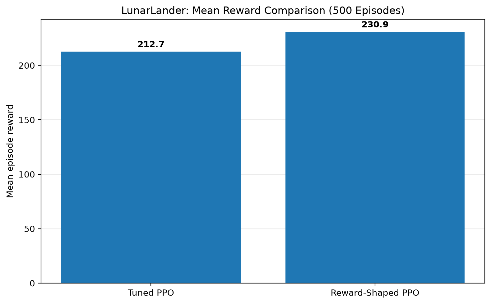
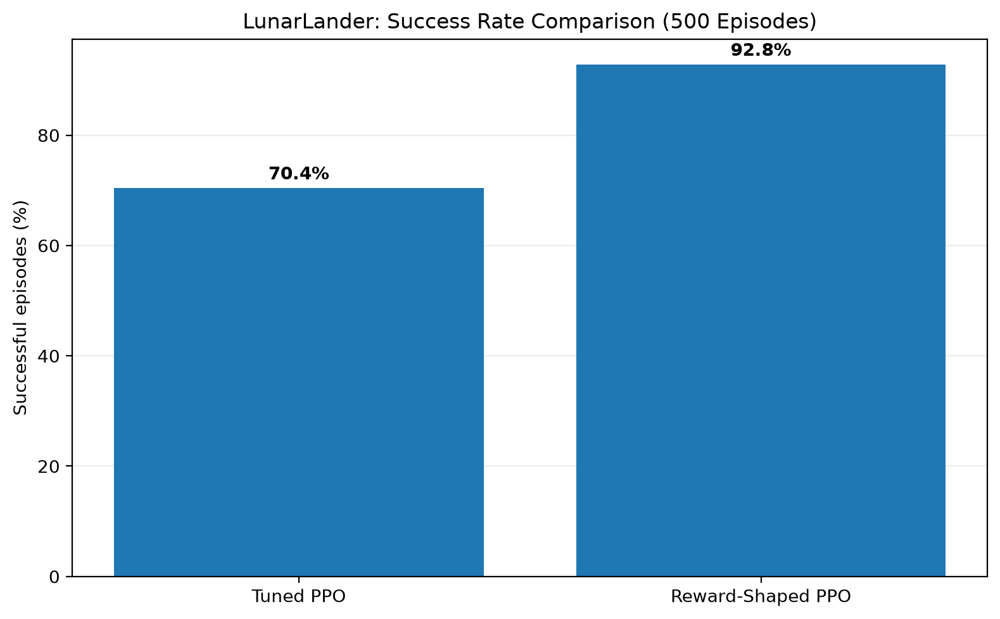

# Autonomous Lunar Lander with Proximal Policy Optimization (PPO)

An applied reinforcement learning project implementing, tuning, and evaluating **Proximal Policy Optimization (PPO)** agents on Farama Foundation's **LunarLander-v3** environment using **Stable-Baselines3** and **PyTorch**.

---

## 1. Project Overview

The goal of the **LunarLander-v3** environment is to pilot an autonomous lunar lander safely to a landing pad designated by two flags:

* **Observation Space (8 Dimensions):** Continuous state vector comprising horizontal position $x$, vertical position $y$, linear velocities $v_x$ and $v_y$, lander orientation angle $\theta$, angular velocity $\omega$, and two boolean contact indicators for the left and right landing legs.
* **Action Space (Discrete 4):**
  * `0`: No operation (coast)
  * `1`: Fire left orientation engine
  * `2`: Fire main thruster
  * `3`: Fire right orientation engine
* **Objective & Success Criterion:** As implemented in the project evaluation suite (`evaluation/compare.py`), an episode is classified as successful when the total unshaped episode reward is **$\ge 200$**.

This project investigates three distinct experimental configurations:
1. **Baseline PPO:** Standard default PPO configuration.
2. **Tuned PPO:** Algorithmic hyperparameter tuning designed to prevent early entropy collapse and stabilize long-horizon credit assignment.
3. **Reward-Shaped PPO:** Tuned PPO trained in a custom environment wrapper that provides targeted velocity dampening and touchdown bonuses, subsequently evaluated strictly on the unmodified environment.

---

## 2. Methodology

### Proximal Policy Optimization (PPO)
PPO is an on-policy actor-critic algorithm that alternates between data collection and gradient optimization. It optimizes a surrogate objective function using clipped probability ratios:

$$L^{CLIP}(\theta) = \hat{\mathbb{E}}_t \left[ \min\left(r_t(\theta)\hat{A}_t, \, \text{clip}(r_t(\theta), 1-\epsilon, 1+\epsilon)\hat{A}_t\right) \right]$$

This clipping prevents destructive policy updates by bounding the difference between the updated and previous policy distributions.

### Hyperparameter Configurations
All training pipelines use 4 parallel environments created via `make_vec_env` with an environment seed of `42`, training for **500,000 total timesteps** using an MLP policy (`MlpPolicy`):

| Hyperparameter | Baseline PPO (`training/baseline.py`) | Tuned PPO (`training/tuned.py`) | Rationale / Purpose |
| :--- | :--- | :--- | :--- |
| **Learning Rate** | `3e-4` | `3e-4` | Standard Adam optimizer step size |
| **Rollout Buffer (`n_steps`)** | `1024` (4096 samples/iter) | `1024` (4096 samples/iter) | $4\text{ envs} \times 1024\text{ steps}$ per policy update |
| **Batch Size** | `64` | `64` | Mini-batch size per optimization step |
| **Optimization Epochs (`n_epochs`)** | `10` (640 gradient steps/iter) | **`4`** (256 gradient steps/iter) | Reduces excessive policy updates on the same data batch |
| **Entropy Coefficient (`ent_coef`)**| `0.0` | **`0.01`** | Encourages exploration; prevents premature action collapse |
| **Discount Factor (`gamma`)** | `0.99` | **`0.999`** | Lengthens planning horizon for late-episode landing bonuses |
| **GAE Lambda (`gae_lambda`)** | `0.95` | **`0.98`** | Smooths Generalized Advantage Estimation over long descents |

### Reward Shaping Wrapper (`environment/custom_lander.py`)
During training of the reward-shaped agent, `CustomLunarLander` wraps `LunarLander-v3` to supply intermediate feedback while preserving all underlying physics:

* **Original Environment Reward:** Base step rewards for distance to pad, speed reductions, tilt penalties, main/side thruster fuel usage ($-0.3$ and $-0.03$), and touchdown/crash terminal signals ($+100$ / $-100$).
* **Low-Altitude Velocity Penalty:** When the lander is in the low-altitude landing zone ($y < 0.5$), an auxiliary penalty is subtracted proportional to combined linear velocity:
  $$\Delta r_{\text{speed}} = -0.1 \times \left(|v_x| + |v_y|\right)$$
* **Stable Landing Bonus:** A terminal bonus of **$+10.0$** is awarded if the episode terminates with all of the following conditions met:
  * Both landing legs in contact (`obs[6] > 0` and `obs[7] > 0`)
  * Lander nearly upright ($|\theta| < 0.1\text{ rad}$)
  * Minimal residual velocities ($|v_x| < 0.2$ and $|v_y| < 0.2$)

> **Important Technical Note:** Reward shaping was applied **exclusively during training**. All final benchmarks and evaluations are executed on the original, unmodified `LunarLander-v3` environment.

---

## 3. Results and Comparison

### Primary Benchmark: 500-Episode Paired Evaluation
The Tuned PPO and Reward-Shaped PPO checkpoints were evaluated side-by-side using `evaluation/compare.py` across **500 identical evaluation seeds (3000–3499)** in the original, unshaped `LunarLander-v3` environment:

| Model | Evaluation Episodes | Mean Reward | Reward Std Dev | Successful Episodes ($\ge 200$) | Success Rate |
| :--- | :--- | :--- | :--- | :--- | :--- |
| **Tuned PPO** | 500 (seeds 3000–3499) | 212.70 | 26.36 | 352 / 500 | 70.4% |
| **Reward-Shaped PPO** | 500 (seeds 3000–3499) | **230.93** | 37.83 | **464 / 500** | **92.8%** |

* **Paired Comparison:** On identical seeds, Reward-Shaped PPO achieved a $+18.23$ higher mean reward than Tuned PPO and scored higher on **471 out of 500 seeds (94.2% head-to-head win rate)**.
* **Success Rate:** Successful landings increased by $+22.4\%$ absolute percentage points (reducing failure/crash events from 148 to 36).

### Baseline Evaluation (Separate 50-Episode Run)
The initial Baseline PPO agent was evaluated in a separate run over 50 episodes (seeds 1000–1049) using `evaluation/evaluation.py`:

| Model | Evaluation Episodes | Mean Reward | Reward Std Dev | Successful Episodes ($\ge 200$) | Success Rate |
| :--- | :--- | :--- | :--- | :--- | :--- |
| **Baseline PPO** | 50 (seeds 1000–1049) | 98.97 | 118.80 | 14 / 50 | 28.0% |

*(Note: Baseline results reflect early validation on 50 episodes and are not directly paired with the 500-episode benchmark above.)*

---

## 4. Evaluation Charts

### Mean Reward Comparison


*Figure 1: Mean unshaped reward across the 500-episode paired evaluation, showing an improvement from 212.70 to 230.93.*

### Success Rate Comparison


*Figure 2: Percentage of landing episodes reaching or exceeding the success threshold ($\ge 200$), increasing from 70.4% to 92.8%.*

---

## 5. Visual Demo

The visual demonstration script runs the trained agent in real-time with Pygame rendering enabled (`render_mode="human"`):

<!-- DEMO VIDEO / GIF PLACEHOLDER: Add recorded landing demonstration MP4/GIF here -->

The agent exhibits controlled vertical deceleration, active counter-thrusting to nullify horizontal drift, and soft dual-leg contact within the landing perimeter.

---

## 6. Installation & Usage

### Setup Virtual Environment (Windows PowerShell)

```powershell
# Clone the repository
git clone https://github.com/Amitkumar-21/lunar_RL.git
cd lunar_RL

# Create and activate virtual environment
python -m venv lunar
.\lunar\Scripts\Activate.ps1

# Install dependencies
pip install -r requirements.txt
```

### Running Training Scripts

```powershell
# 1. Train Baseline PPO (500k timesteps)
python training/baseline.py

# 2. Train Tuned PPO (500k timesteps)
python training/tuned.py

# 3. Train Reward-Shaped PPO (500k timesteps)
python training/shape.py
```

### Running Evaluations & Visual Demo

```powershell
# Run the 500-episode paired benchmark (generates results/large_evaluation.csv)
python -m evaluation.compare

# Launch interactive visual demonstration (5 episodes rendered with Pygame)
python -m evaluation.demo
```

---

## 7. Project Structure

```
lunar_RL/
├── environment/
│   └── custom_lander.py         # Gymnasium reward shaping wrapper
├── evaluation/
│   ├── compare.py               # 500-episode paired evaluation script
│   ├── compare_training.py      # Multi-model evaluation utility
│   ├── demo.py                  # Interactive visual demo with Pygame
│   ├── diagnose.py              # Reward activation diagnostic script
│   ├── evaluate_shaped.py       # Shaped model evaluation
│   ├── evaluation.py            # Baseline evaluation script
│   ├── test_cust_env.py         # Custom environment sanity test
│   ├── validate_shaped.py       # Validation on novel seeds
│   └── validate_tuned.py        # Tuned model validation on novel seeds
├── logs/
│   ├── baseline/                # Baseline evaluation arrays (.npz)
│   ├── shaped/                  # Shaped evaluation arrays (.npz)
│   ├── tensorboard/             # TensorBoard telemetry event files
│   └── tuned/                   # Tuned evaluation arrays (.npz)
├── models/
│   ├── baseline_final.zip       # Final baseline model weights
│   ├── tuned_final.zip          # Final tuned model weights
│   ├── shaped_final.zip         # Final reward-shaped model weights
│   ├── baseline/best_model.zip  # Best training callback checkpoint
│   ├── tuned/best_model.zip     # Best training callback checkpoint
│   └── shaped/best_model.zip    # Best training callback checkpoint
├── results/
│   ├── large_evaluation.csv     # Per-seed 500-episode evaluation logs
│   ├── mean_reward_comparison.png
│   └── success_rate_comparison.png
├── .gitignore
├── requirements.txt             # Pinned project dependencies
└── README.md
```

---

## 8. Technical Details & Limitations

1. **Evaluation in Unmodified Environment:** While the reward-shaped policy was trained using auxiliary incentives (`custom_lander.py`), all reported final metrics were collected strictly in the standard `LunarLander-v3` environment.
2. **Context-Specific Improvement:** These experiments demonstrate that near-ground velocity dampening and terminal stability bonuses effectively resolved high-speed touchdown failures in LunarLander-v3. They do not imply that reward shaping is universally required or beneficial for all RL control environments.
3. **Discrete Action Space:** The lander operates under discrete on/off engine states. Fine continuous throttle modulation is left for future exploration with continuous-action algorithms (e.g., SAC or Continuous PPO on `LunarLanderContinuous-v3`).
